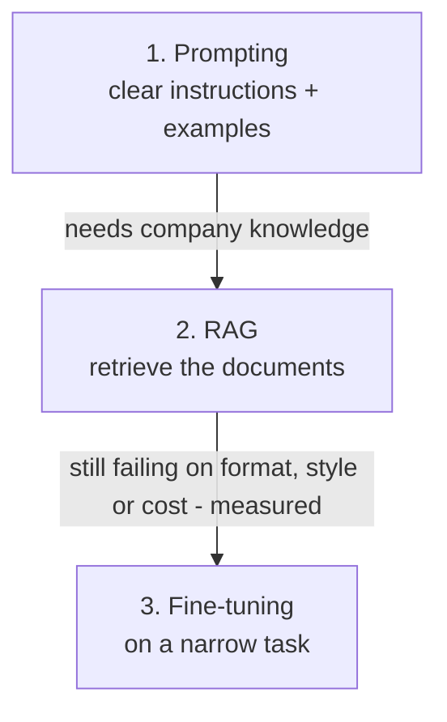

Three ways to make a model do what the customer needs. They solve different problems, and they combine.

| | Prompting | RAG | Fine-tuning |
|---|---|---|---|
| **Changes** | The instructions | The information the model sees | The model's behaviour |
| **Best for** | Task definition, rules, format | Facts, documents, anything that changes | Consistent style or format at scale; narrow tasks; cost |
| **Time to first result** | Minutes | Days | Weeks |
| **Update cost** | Edit text | Re-index a document | Collect data and retrain |
| **Cites sources** | No | Yes | No |
| **Respects permissions** | n/a | Yes, with filtering | No |

## The order to try them

1. **Prompt first.** Most "the model doesn't understand our task" problems are prompt problems. Few-shot examples (topic 8) go a long way.
2. **RAG for knowledge.** If the problem is "it doesn't know our policies", retrieval is almost always the answer.
3. **Fine-tune last**, for a measured gap that prompting and RAG can't close: a format the model keeps breaking, a tone it can't hold, or a cost target only a small specialised model can hit.

## They combine

A mature system might use a fine-tuned small model that classifies and routes tickets, RAG for the policy facts, and prompts for the rules. The question is never "which one?" but "which problem does each solve here?"

## The eval decides

You only know fine-tuning helped if the golden set says so. No eval, no fine-tuning project.
