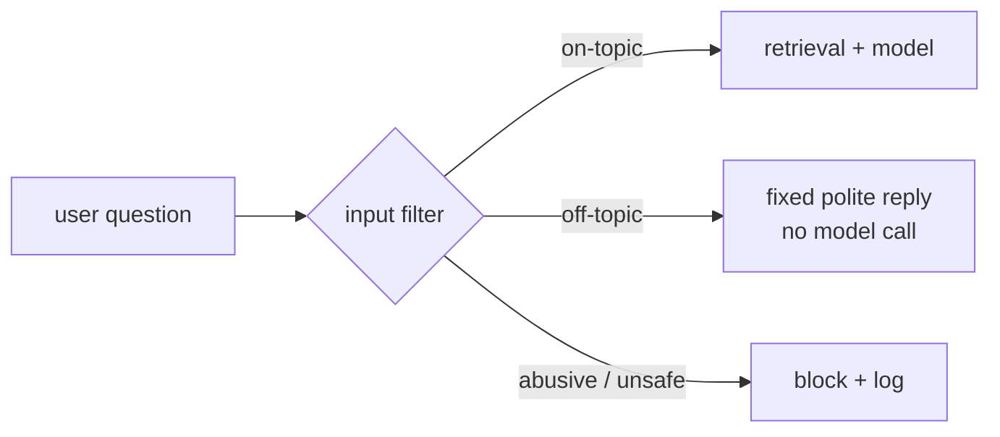

A support bot for a logistics company will be asked to write poems, do homework, give medical advice, and say something embarrassing about competitors. Every one of those requests costs money, and some of them end up in screenshots on social media.

**Input filters** run *before* the main model call and decide whether a request should reach it at all.



## Kinds of input filter

| Filter | How | Cost |
|---|---|---|
| **Length and format** | Reject empty input or 20,000-character pastes | Free |
| **Blocklist** | Regex for obvious abuse, known injection phrases | Free |
| **Topic check by similarity** | Max cosine similarity between the question and the customer's documents; below a threshold = off-topic | One embedding call - often already needed for retrieval |
| **Classifier model** | A small model labels the request: on-topic, off-topic, unsafe | One cheap chat call |
| **Provider moderation** | A moderation endpoint for hate, self-harm, violence | Usually free or cheap |

## Similarity as a topic filter

You already embed the question for retrieval. If even the **best** match is far from every document, the question isn't about anything the bot knows:

```text
0.71  How do I track my parcel?        -> on-topic
0.15  What's the best laptop to buy?   -> off-topic
```

Choose the threshold from real data: score a set of real on-topic questions and a set of off-topic ones, and pick a value between the two clusters. Re-check it when you change embedding models - scores aren't comparable across models.

## Reply, don't just block

An off-topic reply should be **fixed, polite and helpful**: say what the bot *can* do. It's also free - no model call - which matters when someone scripts 10,000 poem requests.
