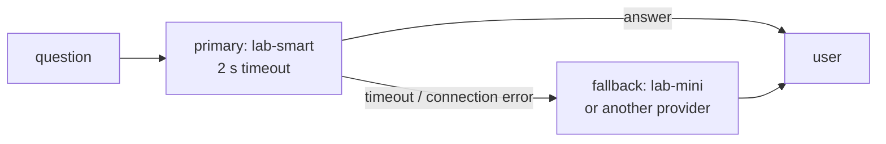

Model providers have bad minutes. Latency spikes from 2 seconds to 40, a region goes down, rate limits kick in during a traffic peak. Your customer's support page shouldn't spin forever because of it.

## Always set a timeout

The OpenAI SDK's default timeout is **10 minutes**. A user won't wait that long; your web server's workers will pile up waiting. Set one explicitly:

```python
primary = OpenAI(timeout=2.0, max_retries=0)
```

- **`timeout`** - seconds before the SDK gives up and raises `APITimeoutError`.
- **`max_retries`** - the SDK retries some failures automatically (default 2). With a fallback in place, retrying the slow primary just doubles the wait.

Choose the timeout from your latency data: comfortably above normal p95, well below what users tolerate.

## Fall back to something that works



| Fallback | When |
|---|---|
| **Smaller model, same provider** | Primary model overloaded |
| **Same model, another region or provider** | Provider or region outage |
| **Cached answer** | FAQ traffic (topic 33) |
| **Graceful message** | Everything is down - "We're having trouble, here's how to reach the team" |

## Rules for fallbacks

- **Catch specific errors** - timeouts, connection errors, 429 and 5xx. Don't fall back on a 400: your request is broken, and the fallback will fail too.
- **Log every fallback** - a spike means the primary is in trouble, and it changes quality.
- **Evaluate the fallback too.** If `lab-mini` is what users get during an outage, it needs to pass the golden set at an acceptable level.
- **Test it** - point the primary at something slow and watch the fallback fire. That's the next task.
