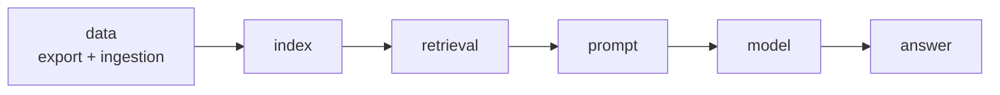

A bad answer has a cause somewhere in the pipeline. Your job is to find **which stage** - and prove it with evidence, not guesses.

## Work backwards

1. **Find the request.** User, time and question from the complaint -> the `request_id` in the call log. Watch for near-duplicates: retries, other users, the same question on other days.
2. **Read the answer and its citations.** What did it say, and which sources did it claim?
3. **Check retrieval** for that request id. Was the right document in the retrieved set? With what score? Which index version?
4. **If the right document is missing**, find out why: did it exist in that index version? Check the ingestion logs.
5. **If it was retrieved**, look at the prompt version and the model output - the problem is generation.
6. **Compare with a good run.** The same question answered correctly last week is the best control: what changed in between?

## Name the stage

| Stage | Evidence looks like |
|---|---|
| **Data** | The source document was missing, empty or wrong in the export or index |
| **Retrieval** | The document was indexed but ranked too low for this query |
| **Prompt** | The right source was in the prompt; the instructions led the model astray |
| **Model** | Right source, sound prompt, the model still invented or misread |

## Close the loop

- **Fix** the cause, not the symptom: a re-index with a guard against empty documents, not a prompt rule saying "damage is 7 days".
- **Add the question to the golden set** so it can't silently come back.
- **Tell the customer** what happened, what you changed and how you'll catch it next time - in plain words, the same day.
