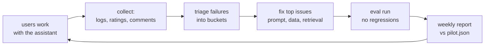

A pilot isn't a waiting room. It's the fastest learning period of the whole engagement - if you set up the loops to learn from it.

## The weekly rhythm

- **Collect** continuously: call logs (topic 35), thumbs up/down, free-text comments, escalations.
- **Triage** weekly: read every thumbs-down. Bucket them - missing document, wrong retrieval, prompt issue, out of scope, user error.
- **Fix** the top two or three buckets. Each fix starts by adding the failing cases to the golden set.
- **Evaluate** before releasing a fix (topic 28) - no regressions.
- **Report** against the pilot criteria every week, in the same format.

## Talk to the users

Numbers tell you *what*; users tell you *why*. A 20-minute call with two agents every week finds problems no log will show: "I stopped using it for invoice questions because it always cites the old policy." Sit with them while they work if you can.

## Close the loop visibly

When a user's complaint leads to a fix, tell them. "You flagged the pallet label answer on Tuesday; it's fixed in today's release." Nothing drives adoption like users seeing their feedback matter.
