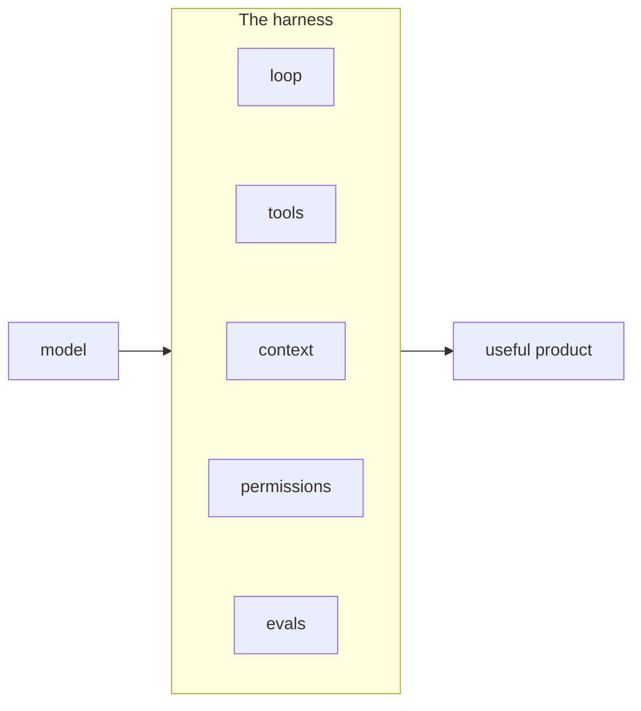

In this lesson you will learn what a harness is, and why the AI model itself is only one part of any real AI product.

Imagine a company builds a support bot. An engineer writes ten lines of code: take the customer's message, send it to a powerful model, return the answer. The demo looks amazing. They ship it.

Two weeks later the tickets arrive. The bot invented a refund policy that does not exist. It forgot what the customer said three messages ago. It told one user to run a command that deleted their data. The model did not get worse. The product was never finished.

## The model is an engine, not a car

A model on its own is like a car engine sitting on the floor of a garage. Powerful, yes. Useful for driving to work? No. You need a frame, wheels, brakes, a steering wheel, and seat belts around it before anyone can go anywhere safely.

The harness is everything you build around the model:

- **The loop** that lets the model take several steps, not just one
- **Tools** the model can ask for, like reading a file or querying a database
- **Context management** that decides what the model sees on each call
- **Permissions** that decide what the model is allowed to do
- **Evals** that prove the whole thing actually works

## Why this matters for you

Companies can all buy the same models. What they cannot buy is a good harness. The refund policy the bot invented? A harness with a verification step catches that. The forgotten message? Context management. The deleted data? Permissions. Every famous failure of an AI product is usually a missing harness part, not a bad model.

That is the job of a harness engineer: you take a raw model and build the machinery that makes it safe, useful, and cheap to run.

Next, let's see how this job differs from what most people try first: rewriting the prompt again and again.
