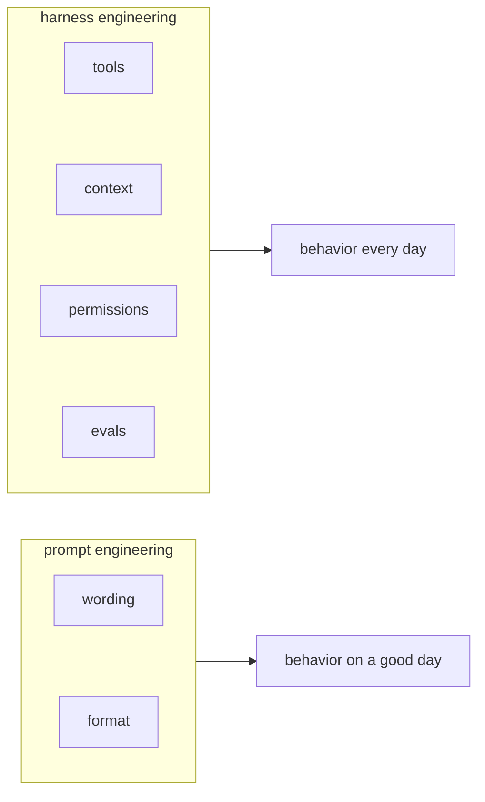

In this lesson you will learn the difference between tuning a prompt and engineering a harness, and which problems each one can actually fix.

Picture a team whose deploy bot keeps failing. Their fix, every single time, is to edit the prompt. Version 14 says "You are a careful DevOps assistant. NEVER guess. ALWAYS double check." The bot still guesses. Why? Because the problem was never the wording.

## What prompt engineering can fix

Prompt engineering is choosing the words you send to the model. It is real work and it matters. A good prompt can fix:

- Tone and format ("answer in JSON", "be brief")
- Missing instructions the model genuinely did not have
- Ambiguous requests that could be read two ways

Careful though: a prompt is a request, not a guarantee. The model tries to follow it. Trying is not the same as always doing.

## What only the harness can fix

Some failures cannot be fixed with words, because they come from the system around the model:

- The model cannot see a file it needs? No prompt fixes that. The harness must give it a **tool**.
- The model ran out of room and forgot early messages? The harness must manage **context**.
- The model ran a dangerous command? The harness must block it with **permissions**, because "please be careful" is not a security control.
- You do not know if version 14 is better than version 13? Only **evals** can tell you.

## A simple test

When something fails, ask: would a very careful human with the same information and the same abilities have succeeded? If no, the prompt cannot save you. Change what the model can see and do. That is harness work.

Next up is a scenario: a team with a beautiful prompt and a bot that still fails. You decide what they should do.
