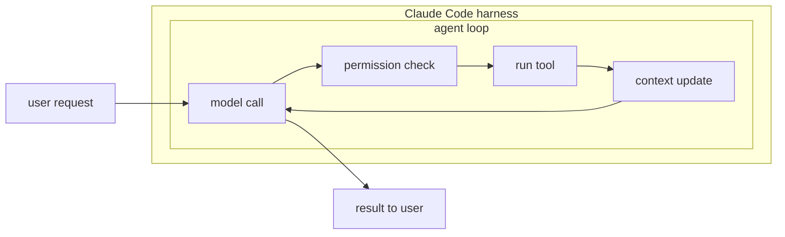

In this lesson you will learn the parts of a production harness by looking at a real one: Claude Code, the coding agent installed on this machine.

When you type a request into Claude Code, it feels like you are talking to a model. You are not. You are talking to a harness, and the model is one component inside it. Let's open it up.

## The parts

**The loop.** Claude Code does not make one model call per request. It calls the model, the model asks to run a tool, Claude Code runs it, feeds the result back, and calls the model again. That repeats until the task is done. The loop is the heartbeat of the harness.

**Tools.** The model cannot touch your machine. It can only ask. Claude Code offers tools like reading a file, editing a file, and running a shell command. Each tool is ordinary code that the harness executes on the model's behalf.

**Context management.** Every model call must carry everything the model needs: the system prompt, the conversation, tool results. When that grows too large, Claude Code compacts it, summarizing old steps so new ones still fit.

**Permissions.** Before running a risky command, Claude Code stops and asks you. The model does not decide what is allowed. The harness does, with rules the model cannot talk its way around.

**Evals.** You do not see this part while using it, but the team behind Claude Code runs large test suites to check that a change to any of the parts above makes the agent better, not worse.

## Why look at a real one first?

Because every harness you will build in this skill has the same skeleton. A support bot, a deploy agent, a log analyzer: loop, tools, context, permissions, evals. Only the details change. We will return to Claude Code near the end of the skill and extend it ourselves.

Time for a quick check on what you have learned about harnesses.
