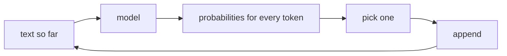

Every large language model (LLM) does one thing, over and over: given some text, it predicts **the next token** - a word or piece of a word.

```text
The capital of France is  ->  " Paris"   (very likely)
                              " a"       (possible)
                              " located" (possible)
```

The model doesn't look anything up. It computes a probability for every token in its vocabulary (often 100,000 or more), picks one, appends it to the text, and runs again with the longer text. A whole answer is just this loop, one token at a time, until the model predicts a special "stop" token or hits a limit.



## Why this matters to a harness builder

This one fact explains most of the behaviour your harness has to manage:

- **Fluent is not the same as true.** The model produces text that *looks like* a likely continuation. A confident tone is the normal output, whether the content is right or wrong.
- **Longer answers cost more and take longer**, because each output token is one more pass through the model.
- **The prompt steers everything.** The model only continues what it's given - so the text you put in (instructions, documents, examples) is your main control.
- **Randomness is a setting.** "Pick one" can mean "always the most likely token" (temperature 0) or "sample, with some variety" (higher temperature).

## Chat models are still continuing text

A chat API looks like a conversation, but underneath, the messages are formatted into one long text with role markers, and the model continues it with the assistant's turn. Same loop.

Notice that this is already a loop with a stop condition - the same shape as the agent loops you'll build from topic 07. In the task you'll watch it yourself: you'll ask for exactly **one token** at a time with `max_tokens=1`, append it, and ask again.
