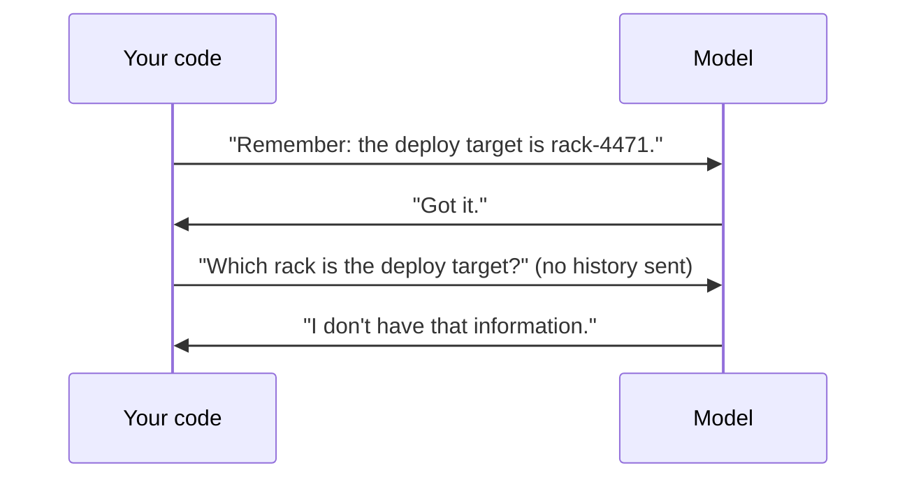

The model is a function: text in, next token out. It has no memory, no eyes on your systems, and no sense of whether it is right. Three failure modes follow directly, and nearly every part of a harness exists to contain one of them.

## Forgetting: the model is stateless

Each API call starts from nothing. The model doesn't remember the previous call - not your name, not the file it read, not the plan it made. The only "memory" is whatever text **you** send in this request.

Chat apps feel like they remember because the app re-sends the whole conversation every time. That re-sending is harness work - and so is deciding what to drop when the conversation no longer fits (topics 10, 17 and 18).

## Drift: long tasks wander

Over many steps, early instructions get buried under tool results and chatter. The model starts following the most recent, loudest text instead of the original goal: it fixes a different bug, reformats files nobody asked about, or slowly relaxes a rule it obeyed at step one.

Harness fixes: keep the goal and rules in the system prompt (which you resend every call), compact noise away, and cap the number of steps.

## Hallucination: fluent guesses

When the right answer isn't in the context, next-token prediction still produces the most plausible-looking text. Ask about a config file the model has never seen and you may get a confident, invented value. The model isn't lying; it's continuing text.

Harness fixes: give it a **tool** to look things up, **retrieve** the right documents into context, and **verify** answers before they reach a user.

## The map you'll fill in

| Failure | What causes it | Harness part that contains it |
|---|---|---|
| Forgetting | Each call is stateless | History and context management |
| Drift | Goal buried under recent text | System prompt, compaction, step limits |
| Hallucination | No source of truth in context | Tools, retrieval, verification |
| Doing something harmful | The model will try what it's asked | Permissions and sandboxes |

In the next task you'll trigger the first one on purpose and see that the fix is in your code, not the prompt.
