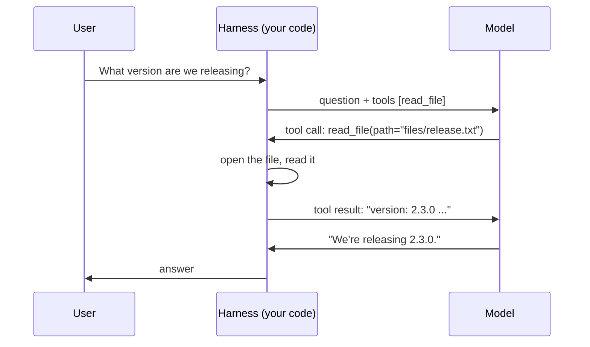

A model can only produce text. It can't open a file, run a command or query a database. **Tool calling** (also called function calling) is the primitive that lets it *ask your code* to do those things - and it is the foundation every harness in this skill is built on.

## How it works

1. You send the request **plus a list of tools** your code can run, each with a name, a description and a schema for its arguments.
2. The model decides whether a tool would help. If so, instead of an answer it returns a **tool call**: a tool name and arguments as JSON.
3. **Your code** runs the tool and sends the result back as a new message.
4. The model reads the result and either answers or asks for another tool.

## The model never runs anything

The model only **proposes** a call. Your harness decides whether to run it, with what permissions, and what to send back. That one fact is why harness engineering exists:

- **Permissions** live in the code that runs the tool (topic 21).
- **Sandboxes** limit where that code can reach (topic 22).
- **Result shaping** decides how much of the output the model sees (topic 13).
- **Injection defenses** treat the result as untrusted text (topic 23).

## Text in, text out - still

A tool call is just structured text the model generated: `{"name": "read_file", "arguments": "{\"path\": \"files/release.txt\"}"}`. It can be malformed, name a tool that doesn't exist, or pass a path you never intended. Treat it like any other model output: parse it, validate it, and only then act on it.
