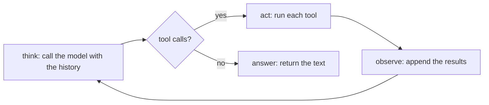

In topic 06 you made one cycle: call the model, run its tool, call again. Real tasks need more. To answer "which port does the billing service use?" in an unfamiliar project, an agent has to list the folder, spot the right file, read it, and only then answer. The number of steps isn't known in advance - **the model decides**.

That's what an **agent loop** is: keep cycling until the model stops asking for tools.



## The whole loop

```python
def run(question):
    messages = [{"role": "system", "content": SYSTEM},
                {"role": "user", "content": question}]
    while True:
        msg = client.chat.completions.create(model="lab-fast", tools=SCHEMAS,
                                             messages=messages).choices[0].message
        if not msg.tool_calls:          # think produced an answer
            return msg.content
        messages.append(msg)            # remember what the model asked for
        for call in msg.tool_calls:     # act
            result = run_tool(call.function.name, json.loads(call.function.arguments or "{}"))
            messages.append({"role": "tool", "tool_call_id": call.id, "content": result})  # observe
```

That's it - about fifteen lines. Every coding agent, support agent and research agent you've heard of has this loop at its centre. Everything else in this skill is about making it **safe, bounded, cheap and correct**.

## What each part does

| Part | In the code | Harness question it raises |
|---|---|---|
| Think | the model call with the full history | What goes into the history? (topics 10, 17, 18) |
| Act | `run_tool` | Which tools, and what may they touch? (topics 12-15, 21, 22) |
| Observe | appending the `tool` message | How big and how trustworthy is the result? (topics 13, 23) |
| Stop | `if not msg.tool_calls` | What if it never stops? (topic 08) |

## The loop has a known hole

`while True` trusts the model to stop. A confused model can call `list_dir` forever, burning tokens on every turn. You'll close that hole in the next topic. For now, build the loop and watch it work.
