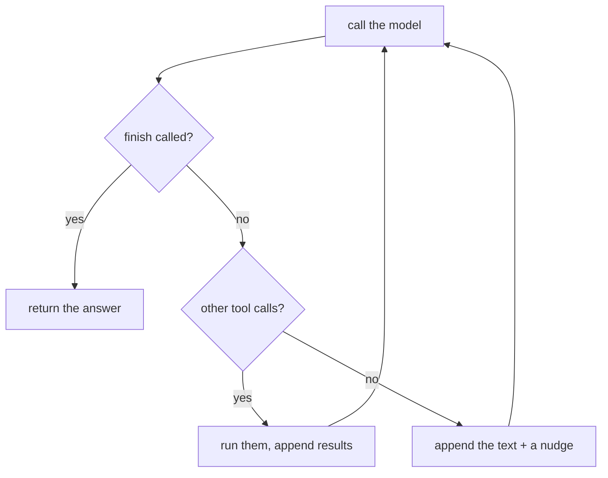

Your topic 07 loop stops when a reply has no tool calls. That's the **implicit** done signal, and it has a real weakness: models often emit text *in the middle* of a task.

```text
step 1  assistant: "Let me look at the services folder first."     <- no tool call
        loop: no tool calls, so... return "Let me look at the services folder first."
```

The user gets a sentence about what the agent was *going* to do. The task is not done.

## The explicit done signal

Give the model a `finish` tool and make calling it the **only** way to end successfully:

```python
FINISH = {"type": "function", "function": {
    "name": "finish",
    "description": "Call this exactly once, when the task is complete, with your final answer for the user.",
    "parameters": {"type": "object", "properties": {"answer": {"type": "string"}}, "required": ["answer"]}}}
```

Now the loop has three cases:

| The model replies with | The harness |
|---|---|
| a call to `finish(answer)` | returns `answer` - done |
| other tool calls | runs them, appends the results, loops |
| plain text, no tools | appends it, adds a **nudge** - "Call finish with your final answer when you are done" - and loops |



## Why it's better

- **Intent is unambiguous.** Text means "thinking out loud"; `finish` means "I'm done".
- **The answer is structured.** You can require extra fields - `confidence`, `files_changed`, `sources` - and validate them.
- **The harness can check before accepting.** Later you'll run a verifier on the `finish` payload before returning it (topic 27).

## Bound the nudges

A model that ignores the nudge forever is another runaway loop. Allow a couple of nudges, then stop with a clear failure. Bounding every loop is the subject of the next lesson.
