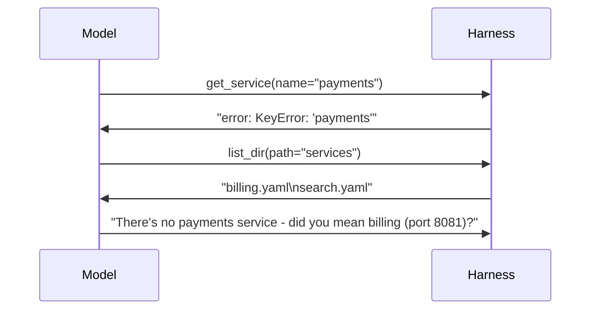

Tools fail all the time. Files are missing, services time out, the model passes `days=90` to a function that accepts 30, or sends arguments that aren't even valid JSON. What the harness does next decides whether the agent recovers or dies.

## The crash

```python
result = IMPL[name](**args)        # KeyError: 'payments'
```

```text
Traceback (most recent call last):
  File "agent.py", line 61, in run
KeyError: 'payments'
```

The whole task is lost - five steps of work, and the user gets a stack trace. Worse, the model never learns what went wrong, so it can't try anything else.

## The message

Catch the exception and send it back as the tool result:

```python
def run_tool(name, args):
    if name not in IMPL:
        return f"error: unknown tool {name}. Available: {', '.join(IMPL)}"
    try:
        return str(IMPL[name](**args))
    except Exception as e:
        return f"error: {type(e).__name__}: {e}"
```

Now the model reads `error: KeyError: 'payments'` and does what a person would: lists the services, notices there is no `payments`, and asks whether you meant `billing`.



## Errors the harness must catch

| Error | Where it happens | Result to send |
|---|---|---|
| Exception inside the tool | `IMPL[name](**args)` | `error: ValueError: days must be 30 or less` |
| Unknown tool name | dispatch | `error: unknown tool X. Available: ...` |
| Wrong or missing arguments | `**args` | `error: TypeError: ... missing 1 required argument` |
| Arguments that aren't valid JSON | `json.loads(call.function.arguments)` | `error: arguments were not valid JSON: {name: search` |

The last one is easy to forget because it happens **before** `run_tool`. It's model output - and model output can be malformed.

## Write errors for the reader

The reader of a tool error is the model. Good error text says **what** failed and, when you can, **what to do instead**: valid choices, the allowed range, "this is permanent, don't retry". You'll practise that in topic 12. The rule for now: **nothing a tool does may crash the loop**. The only things that end a run are the model finishing, or the harness deciding to stop.
