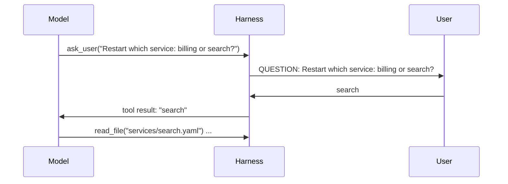

An agent with tools is tempted to always *do something*. When the request is ambiguous, "doing something" means **guessing** - and a confident guess executed by a harness is worse than a question.

> "Restart the service."   Which one - billing or search?
> "Clean up the old configs."   Which are old? Delete or archive?
> "Bump the version."   Major, minor or patch?

## Ask, or find out?

The first rule: **don't ask what you can look up.** If the answer is in a file, a listing or an API, use the tool. Users stop trusting agents that ask "where is the config?" when they could have run `list_dir`.

Ask when the missing piece is something **only the user knows**:

| Ask the user | Look it up |
|---|---|
| Which of two valid targets they mean | Which services exist |
| Their preference or priority | What a config file says |
| Permission for something irreversible | The current status of a service |
| Information that exists nowhere in the system | A port, owner or version number |

## Asking is a tool

The cleanest way to let a model ask is to give it a tool:

```python
{"name": "ask_user",
 "description": "Ask the user one short question when the request is ambiguous or you need a decision "
                "only they can make. Don't ask about things you can find out with the other tools.",
 "parameters": {"type": "object", "properties": {"question": {"type": "string"}}, "required": ["question"]}}
```

The harness implements it however suits the product: `input()` in a terminal, a message in a chat UI, a comment on a ticket. The answer comes back as the tool result, and the loop continues with the ambiguity resolved.



## When nobody answers

Agents often run unattended - in CI, on a schedule, overnight. Then `ask_user` must not hang forever. Return a clear result - `error: the user is not available. Stop and explain what you need from them.` - so the model finishes with a useful "I need to know X" instead of a guess.

## The description does the steering

Whether the model asks too much or too little depends mostly on that description: *when* to ask, and *when not to*. You'll tune tool descriptions properly in topic 12.
