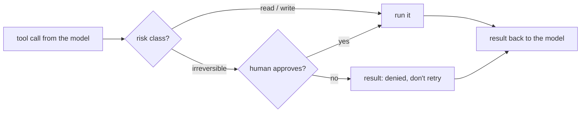

A **confirmation gate** is a checkpoint in `run_tool`: before an irreversible action runs, the harness stops and asks a human. The model can't skip it, because the model never runs anything - it only asks.



## The gate in code

```python
def run_tool(name, args):
    if name not in IMPL:
        return f"error: unknown tool {name}"
    if RISK.get(name, "irreversible") == "irreversible" and not approved(name, args):
        return f"error: the user denied {name}. Do not retry it; ask the user what they want instead."
    return IMPL[name](**args)


def approved(name, args):
    print(f"APPROVE? {name} {json.dumps(args)} [y/N]", flush=True)
    try:
        answer = input().strip().lower()
    except EOFError:            # nobody is there: deny
        answer = ""
    return answer in ("y", "yes")
```

## What makes a good gate

| Property | Why |
|---|---|
| **Shows the exact action** | `delete_file {"path": "old/2023.txt"}`, not "the agent wants to delete something" |
| **Default is no** | `[y/N]` - Enter, silence or a closed stdin all mean deny |
| **Denial is a result, not a crash** | The model learns it was refused and can ask what to do instead |
| **"Don't retry" in the denial** | Without it, some models ask for the same call again immediately |
| **Logged** | Every approval and denial goes to an audit log with the arguments |
| **Can't be argued with** | The model's reasons don't change the rule; only the human's answer does |

## Approval fatigue

If the gate fires on every step, people start pressing `y` without reading. Keep it for the irreversible class, show a short and exact description, and batch when you can ("delete these 3 files?"). A gate that's always approved isn't a gate.

## Where the human is

`input()` is the terminal version. In a chat product, the gate is a button; in CI it's a required review; in a ticket workflow it's a comment from an approver. The shape is the same: pause, show the action, wait for an explicit yes, record the answer.
