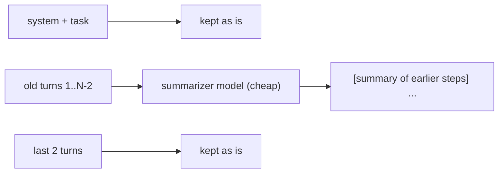

In topic 17 the budget enforcer **dropped** old turns. That keeps the agent inside the window, but whatever those turns found is gone - so the agent may read the same files again, or contradict what it learned. **Compaction** replaces old turns with a short summary instead.

## Three ways to shrink history

| Technique | What it does | Keeps | Costs |
|---|---|---|---|
| **Truncate** | Cut one big tool result to N characters | The start of that result | Nothing |
| **Drop** | Delete the oldest whole turns | Nothing from those turns | Nothing, but loses facts |
| **Compact** | Summarize old turns into one message | The facts that matter, in ~100-200 words | One extra (cheap) model call |

Production harnesses use all three: truncate every result, compact when the history gets big, and drop as a last resort.

## How compaction works



1. **Trigger:** before a model call, if the history (everything after the system prompt and the task) is over a limit - often 70-80% of the window.
2. **Split:** keep the most recent turns verbatim (the model needs the result it just asked for); everything older is summarized.
3. **Summarize:** call a cheap model with a summarizer system prompt and the old turns as plain text.
4. **Replace:** the old turns become one message, marked so everyone can see it's a summary: `[summary of earlier steps]\n...`
5. **Repeat:** next time, the old summary is part of what gets summarized - so there's only ever one summary message.

Split on **whole turns** (an assistant message plus its tool results), exactly like the budget enforcer - never between a tool call and its result.

## The summarizer prompt matters

A summary for a person is not a summary for an agent. Ask for what the agent needs to keep working:

```text
Summarize the earlier steps: which tools were called, what they found
(keep exact names, numbers, paths and error messages), and what is still unknown.
```

"Keep exact values" is the important part. "It found the port" is useless; "billing.yaml says port 8081" is what the agent needs.

## The cost

Each compaction is an extra model call, and it can lose details. Compact rarely (only when over the limit), use a cheap model, and test what survives - that's the second half of this topic.
