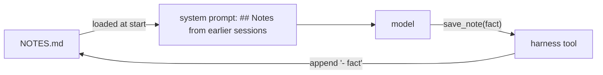

Everything in the context window disappears when the process exits. Run the agent again tomorrow and it knows nothing about yesterday - not the user's preferences, not what it already checked, not the decision you made together. For memory that outlives a run, the harness uses the simplest durable store there is: **files**.

## Short-term vs long-term

| | Context window | Files |
|---|---|---|
| Lifetime | One run | Until deleted |
| Size | Limited, and paid every step | Unlimited, paid only for what you load |
| Who writes | Everything that happens | Only what the agent or harness decides to keep |
| Inspectable | In traces | `cat NOTES.md` - and editable by a person |

## Three kinds of memory file

| File | Holds | Example |
|---|---|---|
| **Notes** | Durable facts and preferences | "The billing team's on-call is Priya", "User prefers YAML answers" |
| **Progress / state** | Where a long task is | The messages so far, or "done: part1-part3, next: part4" |
| **Project instructions** | Rules for this repo or team | `CLAUDE.md` / `AGENTS.md` in coding agents (topic 37) |

## The notes pattern

1. **Read** at the start of every run: the harness appends the notes to the system prompt.
2. **Write** through a tool: `save_note(note)` appends one line. The model decides *what* to remember; the harness decides *how* (format, size limits, where).
3. **Bound it.** One short fact per note, a size limit per note, and a cap or cleanup for the file - notes are loaded into every call.

## Rules for agent-written memory

- **Never secrets.** Notes are plain text loaded into prompts and logs (topic 24).
- **Facts, not transcripts.** "Billing uses port 8081", not a copy of the file.
- **Visible to the user.** A person should be able to read and fix the notes - wrong memories are worse than none.
- **Treat it as untrusted input** if anything other than your agent can write to it - a poisoned memory file is a prompt injection that persists (topic 23).
