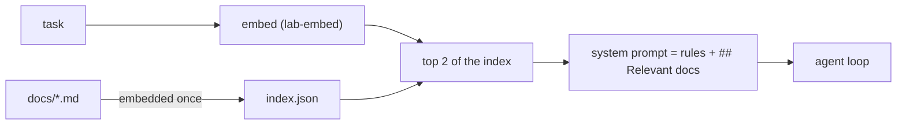

Stackline has hundreds of runbooks. Pasting them all into the system prompt would cost tens of thousands of tokens on **every** step, and bury the two paragraphs that matter. Retrieval picks the relevant few for **this** task and puts only those in context.

You built retrieval in the RAG skill. Here the question is different: not "how do I build a search engine" but **where does retrieved text go in the harness, and when**.

## Three places to retrieve

| When | How | Good for |
|---|---|---|
| **Once, at the start of the task** | Harness embeds the task, adds the top-k docs to the system prompt | Runbooks, policies, how-tos the whole task depends on |
| **Every step** | Harness re-retrieves using the latest messages | Long tasks whose topic drifts |
| **On demand** | A `search_docs(query)` tool the model calls | Open-ended work where the model knows best what it's missing |

Start with the first one. It's predictable, cheap (one embedding call per task), and easy to test: given a task, you can check exactly which docs went in.

## The per-task flow

1. **Index once.** Embed every doc and save the vectors. Re-index when docs change - not on every run.
2. **Retrieve per task.** Embed the task text, rank by cosine similarity, take the top k.
3. **Place it clearly.** A labelled section - `## Relevant docs`, one `### name` header per doc - so the model (and you, reading traces) can tell rules from reference material.

## Choosing k

Small. Two or three good docs beat ten mediocre ones: every extra doc costs tokens on every step, and irrelevant text measurably distracts the model. If the right doc often isn't in the top 2, fix the retrieval (chunking, better doc titles, hybrid search - all in the RAG skill) rather than raising k.
