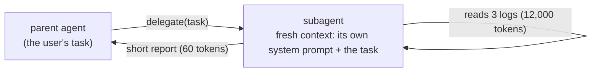

One agent with one growing message list works well for small tasks. On big ones, everything it ever looked at stays in the window: three log files, a directory listing, two wrong guesses. By step 20 the useful facts are a small fraction of a huge prompt - expensive, slow, and easy for the model to lose track of (topics 17 and 18).

## A subagent is a fresh context for one subtask



- The **parent** keeps the user's goal and the big picture.
- The **subagent** starts empty, does one focused job with its own loop and tools, and returns a **short report**.
- The parent's context grows by the report only - not by the 12,000 tokens of logs the subagent read.

## When to use one

| Good fit | Poor fit |
|---|---|
| "Search these logs and tell me which has the slowest request" - lots of reading, small answer | Tasks that need the whole conversation to make sense |
| Research in parallel (topic 26) | Tiny lookups - a subagent costs at least one extra model call |
| Work that needs different tools or a different system prompt | Steps that depend on each other tightly |
| Isolating untrusted content from a privileged agent (topic 23) | |

## How it's built

A subagent is just **your loop again**, called from inside a tool:

```python
def delegate(task):
    return subagent(task)        # a fresh messages list, its own loop, returns a string

PARENT_IMPL = dict(IMPL, delegate=delegate)
```

The parent model sees `delegate` as one more tool. The harness decides what the subagent gets (its system prompt, its tools, a step limit) and what comes back (only its final text, capped). That's how Claude Code's Task tool works, too.
