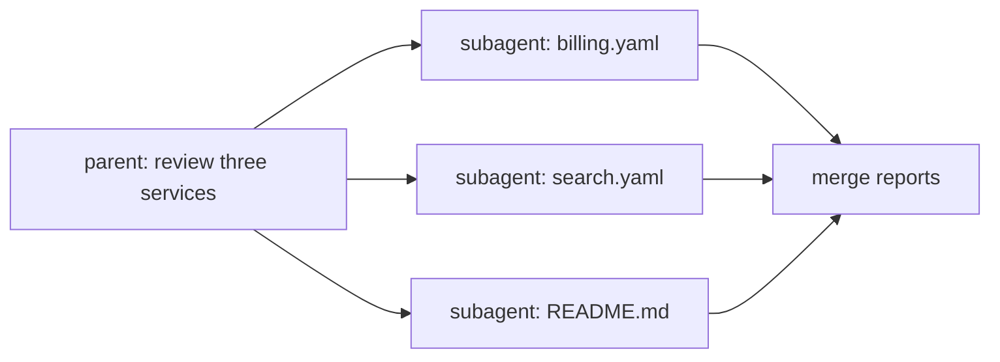

Three subagents that each take 20 seconds take 60 seconds one after another - or about 20 seconds side by side. Model calls spend almost all their time **waiting** on the network, so running independent subagents concurrently is the cheapest speedup in a harness.

## Fan out, fan in



1. **Split** the work into tasks that don't depend on each other.
2. **Fan out:** start a subagent per task, at the same time.
3. **Fan in:** wait for all of them and merge their reports, in a fixed order.

## In Python: a thread pool is enough

Each subagent mostly waits on HTTP, so threads work well:

```python
from concurrent.futures import ThreadPoolExecutor

def run_all(tasks, workers=3):
    with ThreadPoolExecutor(max_workers=workers) as pool:
        return list(pool.map(safe, tasks))     # results in the same order as tasks
```

- `pool.map` returns results **in task order**, whatever order they finish in. Merging stays deterministic.
- `max_workers` is your concurrency limit - and your rate-limit protection.
- Each thread creates its own client (or share one; the OpenAI client is thread-safe).

## One failure must not sink the rest

If one subagent raises - a bad tool argument, a timeout - `pool.map` re-raises it and you lose every other result. Wrap each one:

```python
def safe(task):
    try:
        return subagent(task)
    except Exception as e:
        return f"error: {type(e).__name__}: {e}"
```

The merged report then says exactly which part failed, and the parent can retry just that one.

## Measure it

Record wall-clock time for the whole fan-out. If three 2-second subagents take 6 seconds, they aren't running in parallel - a shared lock, a sequential loop, or a concurrency limit of 1 is hiding somewhere.
