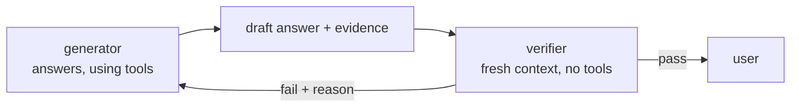

A model's first answer is a draft. It's often right - and when it's wrong, it's wrong **confidently**: "Billing uses port 8080" reads exactly as fluently as the truth. One pass gives you no signal about which kind of answer you got.

## Two roles



- The **generator** is your normal agent loop.
- The **verifier** is a separate model call with its **own** system prompt and context. It gets the question, the evidence the generator collected (tool results), and the draft answer - and returns a structured verdict.
- On **fail**, the harness feeds the reason back to the generator and lets it try again, a limited number of times.
- After the retry limit, the harness returns the answer **marked as unverified** - it doesn't pretend.

## Why a separate context helps

The generator has its own reasoning in its history; asked "are you sure?", it tends to agree with itself. A verifier that sees only the evidence and the claim has nothing to defend. It's the same reason code review works better than rereading your own code.

## What the verifier should return

Structured, so the harness can act on it without guessing:

```json
{"verdict": "fail", "reason": "billing.yaml says port 8081, the answer says 8080"}
```

Parse it strictly. If the verifier's reply isn't valid JSON with a known verdict, treat it as **fail** - a broken checker must not wave answers through.

## Cost and limits

Each verification is an extra call; each rejection is at least two more. Cap the retries (2 is typical), verify only final answers (not every step), and use the cheapest model that verifies reliably. For answers that can be checked by **code** - numbers, file contents, test results - prefer code (next task).
