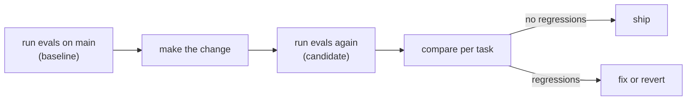

In normal software, a change to one function rarely changes the behavior of an unrelated one. In a harness, **everything is coupled through the model**. Shortening the system prompt, renaming a tool, changing how results are truncated, upgrading the model - any of these can change what the agent does on tasks you never thought about.

## Changes that quietly break agents

| Change | Looked like | Actually did |
|---|---|---|
| "Clean up" the system prompt | Shorter, nicer wording | Dropped "use the tools before answering" - the agent now guesses |
| Rename `search_docs` to `search` | Tidier | The model confuses it with a web search |
| Raise the truncation limit | More context | Costs up 40%, and the model misses the key line in a longer result |
| Upgrade the model | Newer, better | Calls tools in a different order; a step check breaks; one task gets slower |
| New tool | More capability | The model uses it where an old one was better (topic 14) |

None of these show up in a code review. They show up in **evals**.

## Before and after, on the same suite

The workflow for any harness change:

Compare **per task**, not only the score. A score that stays at 5/6 can hide one task that broke and another that got fixed - and the broken one might be your most important safety rule.

| Term | Meaning |
|---|---|
| **Regression** | Passed before, fails now |
| **Fix** | Failed before, passes now |
| **Flaky** | Changes between runs with no change to the harness - run it again, or run each task several times |

## Make the model part of the test setup

To compare two prompts fairly, everything else must stay the same: the same tasks, the same workspace, the same model (and for real models, several runs per task). For harness logic you can go further and use a **scripted model** - like the behavior script in the next task - so the only thing that changes between runs is your harness.
