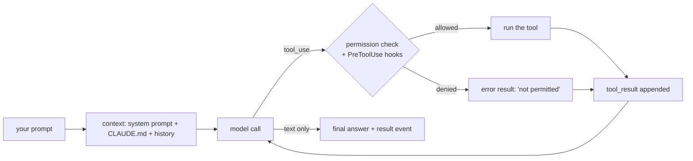

You've spent 33 topics building a harness piece by piece. Claude Code is a production harness built from the same pieces - with years of edge cases handled. Reading it through the lens of this course turns a black box into a design you can copy, extend, or argue with.

## The loop

Claude Code runs the loop from topic 7: send the conversation plus tool definitions, execute any tool calls, append the results, repeat until the model answers without a tool call.

The stop conditions are the ones you built in topic 8: a text-only reply ends the run, `--max-turns` caps it, and the user can interrupt.

## The tools

| Tool | What it does | Course topic |
|---|---|---|
| `Read`, `Write`, `Edit` | Files, with line ranges and exact-string edits | 6, 13 |
| `Glob`, `Grep` | Find files and search content without dumping them | 13, 14 |
| `Bash` | Run shell commands, with a timeout and output limits | 15, 22 |
| `Task` / `Agent` | Spawn a subagent with its own context | 25, 26 |
| `WebFetch`, `WebSearch` | Pull outside content in - untrusted input | 23 |
| `Skill` | Load a packaged instruction set on demand | 37 |
| `mcp__<server>__<tool>` | Tools from MCP servers you add | 35 |

Every description is long and specific - "Avoid using this tool to run `cat`... use the dedicated tool" - exactly the tools-are-prompts lesson of topic 12.

## Permissions

Each tool call passes a permission check before it runs (topic 21):

- **Modes:** `default` (ask for anything not allowed), `acceptEdits` (file edits allowed), `plan` (read-only planning), `bypassPermissions` (everything - sandboxes only).
- **Rules:** allow and deny lists such as `Bash(npm test:*)` or `Read(./secrets/**)`, in `.claude/settings.json` or on the command line with `--allowedTools` / `--disallowedTools`.
- **Non-interactive runs** (`claude -p`) have nobody to ask, so anything not allowed is **denied** and reported back - the model sees an error result and the run's final event lists the denial.

## Context

- The **system prompt** describes the harness itself: how to use tools, when to ask, how to format output.
- **CLAUDE.md** files (topic 36) are injected at the start of the conversation as project instructions.
- **Compaction** (topic 18) summarizes old turns when the window fills; `/compact` does it on demand.
- **Subagents** keep big searches out of the main context (topic 25).

## Seeing what it did

`claude -p "..." --output-format stream-json --verbose` prints one JSON event per line - the transcript from topic 31:

| Event | Holds |
|---|---|
| `system` / `init` | model, tools offered, MCP servers, permission mode, working directory |
| `assistant` | the model's message: text and `tool_use` blocks |
| `user` | `tool_result` blocks (with `is_error`) going back to the model |
| `result` | final answer, `num_turns`, `total_cost_usd`, usage, `permission_denials` |
