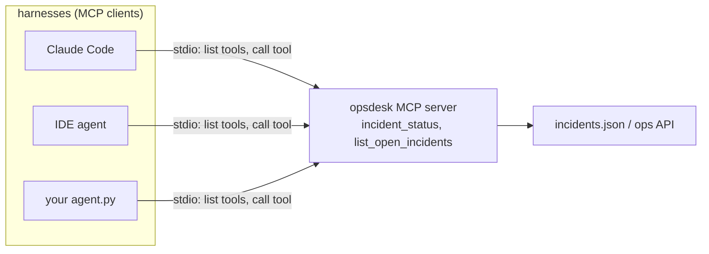

In topic 6 you defined tools as JSON schemas inside your own harness. That's fine for one harness - but your team's tools (the incident tracker, the deploy system, the feature-flag service) should work in **every** harness people use: Claude Code, an IDE, your own agents.

## MCP: one server, every harness

The **Model Context Protocol** is the standard plug between harnesses and tools. You write a **server** that exposes tools; any MCP-capable **client** (harness) can start it, list its tools, and call them.



What the harness does with an MCP tool is exactly what you did by hand:

1. Start the server (a child process for **stdio** servers) and ask it for its tool list.
2. Show those tools to the model next to the built-ins, named `mcp__<server>__<tool>`.
3. When the model calls one, apply **permission rules** (topic 21), forward the call, and put the result in context.

## Writing a server

The official Python SDK's **FastMCP** builds the schema from type hints and the docstring - the docstring is the tool description, so the topic 12 rules apply:

```python
from mcp.server.fastmcp import FastMCP
mcp = FastMCP("opsdesk")

@mcp.tool()
def incident_status(incident_id: str) -> dict:
    """Get one ops incident's status, severity and owning team by its id (like INC-4471). Read-only."""
    ...

if __name__ == "__main__":
    mcp.run()          # stdio
```

## Design rules carry over

| Rule | From topic | In an MCP server |
|---|---|---|
| Few, well-described tools | 12, 14 | Two clear tools beat ten overlapping ones |
| Shape the result | 13 | Return the fields the model needs - drop `internal_notes` |
| Errors as results | 9 | `{"error": "unknown incident INC-9"}`, not a crash |
| Read-only by default | 15 | Mutating tools need permission rules on the client side |
| Never print to stdout | - | stdout **is** the protocol channel; log to a file |
| Untrusted output | 23 | Results can carry injected text - the client still treats them as data |

## Registering it

Claude Code keeps MCP servers at three **scopes**:

| Scope | Stored in | Use for |
|---|---|---|
| `local` (default) | your user config, for this project only | Personal experiments |
| `project` | `.mcp.json` in the repo | Servers the whole team should get - commit it |
| `user` | your user config, all projects | Tools you use everywhere |

For scripted runs (CI, evals) you can skip registration and pass a file: `--mcp-config ci-mcp.json --strict-mcp-config` loads **only** the servers in that file - a reproducible tool set.
