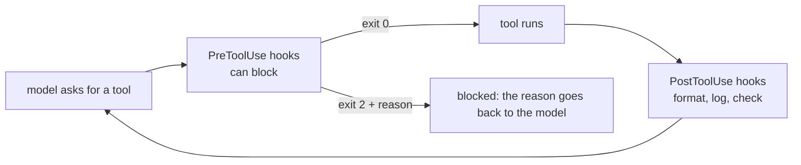

Permission rules answer "may this tool run at all?". Some policies need **code**: "Bash is fine, but never a production deploy", "run the formatter after every edit", "log every command to the audit trail". Claude Code runs your scripts at fixed points in the loop - **hooks**.



## The main events

| Event | Runs | Typical use |
|---|---|---|
| `PreToolUse` | Before a tool call; can **block** it | Policy: block prod deploys, protect files, deny network |
| `PostToolUse` | After a tool call succeeds | Run the formatter/linter after edits, audit logs |
| `UserPromptSubmit` | When a prompt is submitted | Add context, reject prompts with secrets |
| `Stop` | When the agent wants to finish | Refuse to stop until tests pass |
| `SessionStart` | At startup | Load project status into context |

## The contract

A hook is a command. Claude Code sends it a JSON event on **stdin**:

```json
{"hook_event_name": "PreToolUse", "tool_name": "Bash",
 "tool_input": {"command": "./deploy.sh --env prod"}, "cwd": "/repo", "session_id": "..."}
```

and reads the result from the **exit code**:

| Exit code | Meaning |
|---|---|
| `0` | Fine, carry on |
| `2` | **Block** - stderr is sent to the model as the reason |
| anything else | A hook error, shown to the user; the call continues |

Hooks are configured in `.claude/settings.json` (shared with the team) or `.claude/settings.local.json` (just you):

```json
{"hooks": {"PreToolUse": [{"matcher": "Bash",
   "hooks": [{"type": "command", "command": "python \"$CLAUDE_PROJECT_DIR/.claude/hooks/block_prod.py\""}]}]}}
```

`matcher` selects tools by name (a regex such as `Edit|Write`). `$CLAUDE_PROJECT_DIR` is the project root, so the path works from any working directory.

## Hooks vs instructions

"Never deploy to prod" in CLAUDE.md is a **request** - the model usually follows it. A hook is **enforcement** - it runs every time, whatever the model decides. Use instructions for style and workflow, hooks for anything that must never happen (topic 21's blast-radius thinking).

## Hook pitfalls

- **Pattern gaps.** `--env prod`, `--env=prod`, `--env production`, extra spaces, `bash deploy.sh` - test the variants.
- **Fail closed or open?** A hook that crashes on bad JSON lets the call continue (exit 1). For critical policies, catch errors and exit 2.
- **Hooks are code you run** with your permissions - review hook changes like any other code.
