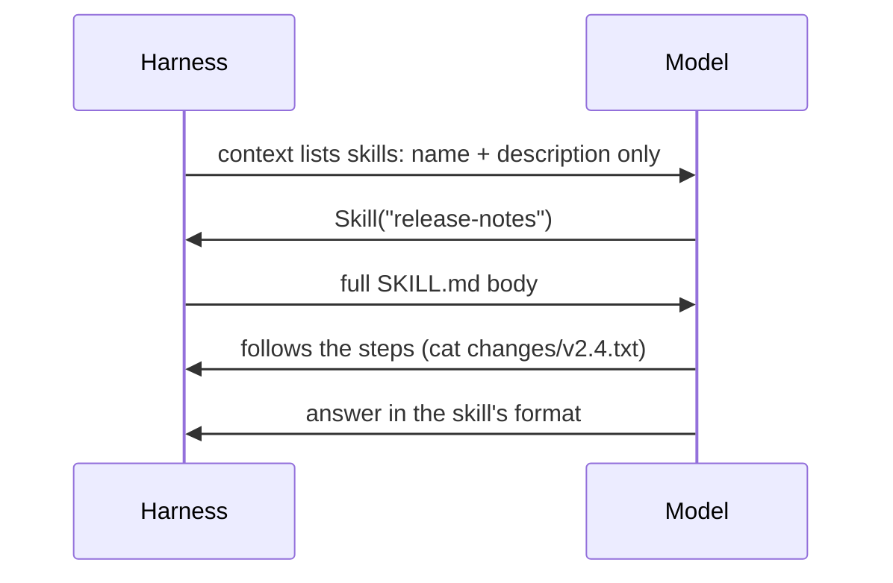

CLAUDE.md is loaded on **every** run. But many instructions only matter for one workflow: how to write release notes, how to triage a bug report, how to run the monthly cost review. Putting all of them in CLAUDE.md wastes the window on every unrelated task (topic 17).

## Skills: instructions loaded on demand

A **skill** is a folder with a `SKILL.md` file - a name, a description, and the full instructions:

```
.claude/skills/release-notes/
  SKILL.md          # frontmatter + steps
  template.md       # optional extra files the steps refer to
```

```markdown
---
name: release-notes
description: Draft release notes for a ledger-api version from its change list. Use when asked for release notes, a changelog, or "what's new" for a version.
---

# Release notes for ledger-api
1. Find the version in the request ...
```

## How the harness uses them



Only the **description** costs context up front. The body loads when the model decides the skill fits - which is retrieval (topic 20) applied to instructions.

## Writing a good skill

| Part | Rule |
|---|---|
| `name` | Lowercase with hyphens, same as the folder |
| `description` | **What** it does + **when** to use it, with the words users actually say ("release notes", "changelog"). The model picks skills from this line alone |
| Steps | Numbered, concrete commands, file names |
| Failure handling | What to do when input is missing - "say so and stop" beats invention |
| Output format | An exact template, so every run looks the same |
| Size | Short; move long references to extra files the steps point to |

## Where skills live

- `.claude/skills/` in the project - shared with the team through git.
- `~/.claude/skills/` - personal, every project.
- Plugins can ship skills too, so a team can distribute a whole toolkit.

## Skill, CLAUDE.md, hook, or MCP?

| Need | Use |
|---|---|
| Always-on project facts and conventions | CLAUDE.md |
| A repeatable multi-step workflow, needed sometimes | Skill |
| A rule that must hold every time | Hook or permission rule |
| A new capability: talk to a system | MCP server |
