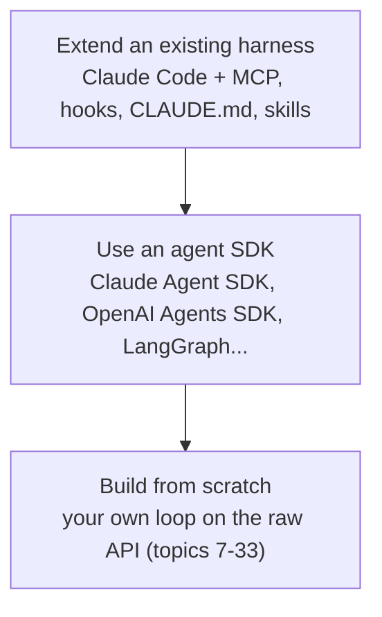

You can now build every layer of a harness yourself - and extend a production one without writing a loop. The question on a real project is which layer to work at.

## The three layers

| | Extend existing | Agent SDK | From scratch |
|---|---|---|---|
| You write | Config, MCP servers, hooks, instruction files | Tools, prompts, orchestration code | Everything |
| Loop, permissions, compaction | Provided | Provided, configurable | Yours |
| Time to first useful run | Hours | Days | Weeks |
| Control over every token | Low | Medium | Full |
| Runs where | Developer machines, CI | Your service | Anywhere |
| Maintenance | Vendor ships improvements | Shared | All yours |

## Choose by the problem

**Extend an existing harness** when the users are developers or operators working in a terminal or IDE, the task looks like coding/ops work, and what's missing is *your* tools and rules. Most internal automation lives here: MCP servers for internal systems, hooks for policy, skills for workflows.

**Use an SDK** when the agent runs **inside your product or service** - a support bot, a back-office pipeline - and you need your own UI, auth, storage and deployment, but don't want to re-invent the loop, tool plumbing and context management.

**Build from scratch** when the loop itself is the product or the constraint: an unusual control flow, strict latency or cost budgets on every call, a model or runtime no SDK supports, regulatory requirements to audit every token, or an environment where you can't run third-party code.

## Questions that decide it

1. **Who runs it, where?** A developer in a terminal, or a customer through your API?
2. **Is the hard part the loop or the tools?** Usually the tools and the context - which every layer lets you own.
3. **What must you control?** Every request (from scratch), the tools and prompts (SDK), or just policy and capabilities (extend)?
4. **Who maintains it in a year?** A from-scratch harness is a product with a backlog.

## What carries over

Whatever the layer, the skills from this course are the job: tool design, context budgets, permissions, injection defense, verification, evals and regression gates. A team that extends Claude Code still needs golden tasks and a gate (topics 30-33) - the harness didn't write those for them.
