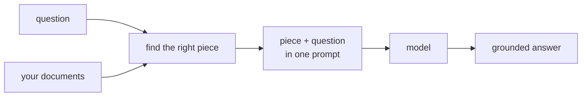

You just fixed the problem by pasting a document into the prompt. That works when you have one small document and you know it holds the answer. Real life is not that kind. A company has hundreds of documents, and nobody knows in advance which one answers the next question.

So the paste-it-in move needs one more step in front of it: first **FIND** the right piece, then paste that piece in. A system that does both steps automatically has a name: **RAG**, short for **Retrieval-Augmented Generation**. Three words, and each one is simple:

- **Retrieval** - find the right piece of your documents.
- **Augmented** - add that piece to the prompt.
- **Generation** - let the model write the answer from it.

## What you will build

In this course you build every box in that picture yourself, in small steps:

1. First you learn **grounding** properly: how to write the prompt so the model uses your document and nothing else.
2. Then you build the **finding** part: embeddings, similarity, and search by meaning. This is the part that feels like magic and is actually simple math.
3. Then you make it work on **real files**: cutting documents into pieces, storing them in a vector database.
4. Then you connect everything into **one pipeline**, first by hand so you understand it, then with real tools (Chroma and LangChain) the way teams run it at work.
5. At the end you build **three complete assistants** as projects.

One promise for the whole course: every new idea comes with a worked example you can run, and then a small task where you do the same thing yourself. You will not read about RAG. You will build it.

Next topic: a short setup so you can call models from Python.
