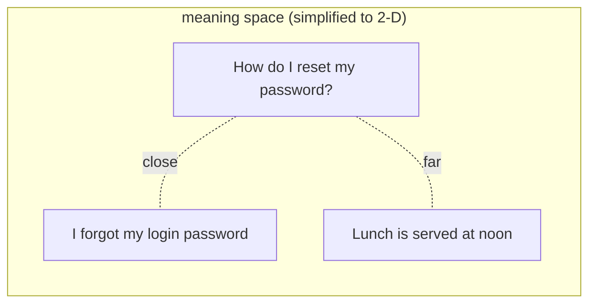

Grounding works when you already know which document holds the answer. To find it **automatically**, a computer has to answer a harder question: *which of my texts mean the same thing as this question?*

Matching words doesn't work. "How do I reset my password?" and "I forgot my login password" share almost no words, yet they mean the same thing. "The bank of the river" and "the bank raised rates" share a word and mean nothing alike.

## Text as a point on a map

An **embedding** is a list of numbers that represents what a piece of text *means*. An embedding model reads the text and outputs, for example, 384 numbers:

```text
"The payments team deploys every Tuesday at 15:00 UTC."
  -> [-0.0152, -0.0265, -0.0245, -0.0295, -0.0316, ... 379 more]
```

Think of each text as a point on a map. A real map uses 2 numbers (latitude, longitude). An embedding uses hundreds, so it can place texts by many aspects of meaning at once - topic, intent, tone. The key property:

> **Texts with similar meaning get points that are close together.**



## What the numbers mean

No single number means "about passwords". Meaning is spread across all of them, learned by training the model on huge amounts of text so that related texts land near each other. You never read the numbers yourself; you **compare** them. Topic 05 shows how.

## Embedding models vs chat models

| | Chat model (`lab-fast`) | Embedding model (`lab-embed`) |
|---|---|---|
| Input | Messages | Text |
| Output | New text | A fixed-length list of numbers |
| Used for | Writing the answer | Finding the right piece |
| Cost | Higher | Tiny - and free here, it runs on your VM |

Your lab's `lab-embed` is **all-MiniLM-L6-v2**, a small, popular open model. It always returns **384** numbers, whatever the length of the text. Bigger hosted models return 1,024 or 3,072, but the idea is identical.

## One rule to remember

Only compare embeddings made by **the same model**. Each model draws its own map; a point from one map means nothing on another. If you change embedding models, you re-embed everything.
