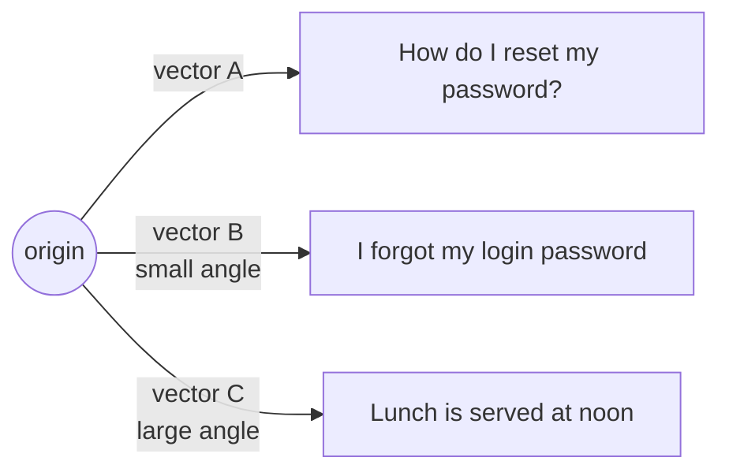

You have two embeddings. How close are they? The standard measure is **cosine similarity**: the cosine of the angle between the two vectors.



- Same direction (angle 0°) -> cosine **1**: same meaning.
- At right angles (90°) -> cosine **0**: unrelated.
- Opposite (180°) -> cosine **-1**. Rare with text models; in practice scores fall between about -0.1 and 1.

## The formula

```text
cosine(a, b) = (a · b) / (|a| × |b|)
```

- **a · b** is the **dot product**: multiply matching numbers and add them up.
- **|a|** is the **length**: the square root of the sum of squares.

Dividing by the lengths means only the *direction* counts, not how long the vectors are.

## In plain Python

```python
import math


def cosine(a, b):
    dot = sum(x * y for x, y in zip(a, b))
    norm_a = math.sqrt(sum(x * x for x in a))
    norm_b = math.sqrt(sum(y * y for y in b))
    return dot / (norm_a * norm_b)
```

Test it on vectors you can check in your head:

```python
cosine([1, 0], [1, 0])     #  1.0  same direction
cosine([1, 0], [0, 1])     #  0.0  right angle
cosine([1, 2], [2, 4])     #  1.0  same direction, different length
cosine([1, 0], [-1, 0])    # -1.0  opposite
```

## The shortcut for normalised vectors

Topic 04 showed MiniLM vectors have length 1. Then the denominator is 1 x 1, and cosine similarity is **just the dot product**. Vector databases use this to go faster. Keep the full formula in your own code anyway - it's correct for any model.

## What is a "good" score?

There is no universal number. Scores depend on the model: MiniLM's related pairs often score 0.5-0.8 and unrelated ones near 0, while other models squeeze everything into 0.7-0.9. What's reliable is the **ranking**: the most related text scores highest. Use absolute thresholds only after looking at real scores for your model - you'll do exactly that in topic 15.
