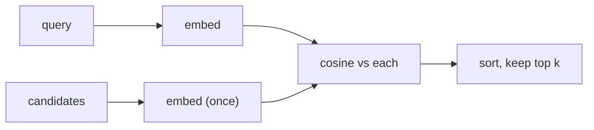

You can now score how close two texts are. **Semantic search** is just that, repeated:

1. Embed every candidate text once.
2. Embed the query.
3. Score the query against every candidate.
4. Sort by score, highest first, and keep the top *k*.

## Why it beats keyword search

Keyword search (like `grep` or a basic site search) finds texts that share **words** with the query. Semantic search finds texts that share **meaning**:

| Query | Keyword search finds | Semantic search finds |
|---|---|---|
| "I want to stop paying every month" | nothing - no FAQ contains "stop paying" | "How do I cancel my subscription?" |
| "app keeps dying" | nothing | "The mobile app crashes every time I open the camera." |

People rarely use the same words as your documents. That's why retrieval in RAG uses embeddings.

## Where keywords still win

Exact identifiers - error codes like `E-4012`, ticket numbers, product SKUs - carry no "meaning" the model can generalise from. Keyword search finds them perfectly. Production systems often combine both (**hybrid search**). For this course, embeddings do the work.

## Top-k

You rarely want only one result. Returning the top 3-5 gives the next step some room: in RAG you pass several pieces to the model so the answer is likely among them. *k* is a tuning knob you'll measure in topic 12.

## Embed candidates once

Candidates don't change between queries, so embed them once and reuse the vectors. Only the query is embedded per search. In this topic everything fits in memory; in topics 08-09 you'll store the vectors so they survive between runs.
