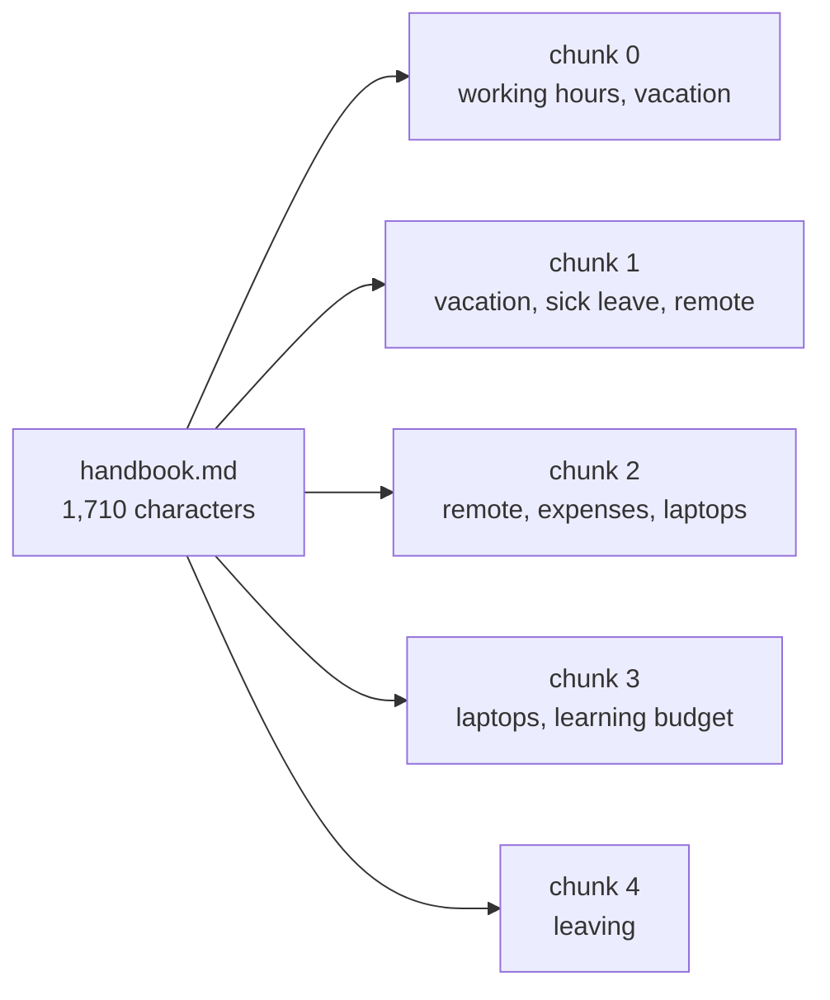

Semantic search works on any text. So why not embed each document whole and retrieve whole documents? Three reasons.

## 1. One vector can't hold many topics

An embedding is a single point in meaning space. The Northwind handbook covers working hours, vacation, expenses, laptops and more. Squeeze all of that into one point and you get an "average" that sits near nothing in particular. A question about stolen laptops scores only weakly against "the whole handbook", even though the answer is right there.

A short, focused piece about laptops gets a sharp point - and scores strongly against laptop questions.

## 2. Precision in the prompt

Retrieval feeds the prompt. If every hit is a whole document, a 30-page policy goes into the prompt to answer one line. That costs more, runs slower, and buries the answer among hundreds of irrelevant lines.

## 3. Model limits

Embedding models have an input limit. MiniLM reads about 256 tokens; text past that is ignored. Even large hosted models stop at a few thousand tokens. Whole documents simply don't fit.

## The fix: chunking

**Chunking** cuts each document into smaller pieces - **chunks** - and embeds each one separately. Retrieval then finds the best *chunks*, not the best documents.

Every chunk remembers where it came from (document name, position), so you can show sources later.

Chunking is the indexing step that decides your RAG quality more than almost anything else: if the answer is split badly, no retriever can find it whole.
