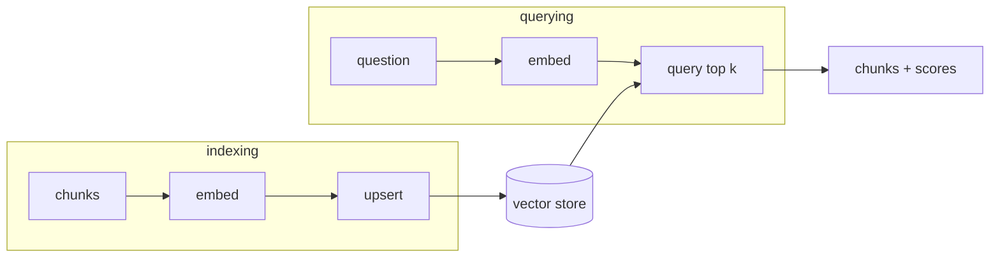

`vectors.json` works, but think about what happens as it grows:

- Every query loads **the whole file** into memory.
- Adding one document means **rewriting** the file.
- Two processes writing it at once can **corrupt** it.
- Nothing stops **duplicates** if you index the same chunk twice.

A **vector store** (or vector database) solves these problems. It stores, for every chunk:

| Field | Example | Why |
|---|---|---|
| `id` | `handbook-003` | Update or delete one chunk; avoid duplicates |
| `text` | `"...report it to the IT service desk within one hour..."` | What goes into the prompt |
| `embedding` | `[0.018, -0.023, ...]` | What search compares |
| metadata | `source: handbook.md` | Show sources, filter by document |

and gives you two operations:

- **upsert** - insert a chunk, or replace it if the ID already exists ("update or insert").
- **query** - given a query vector, return the *k* nearest chunks with their scores.

## Build one before you use one

Real vector databases (Chroma, pgvector, Pinecone, Qdrant, Weaviate) add fast approximate search for millions of vectors. Underneath, the idea is exactly the table above plus "compare the query against stored vectors". You'll build that yourself with **SQLite** - a database in a single file, built into Python - and then move to Chroma in topic 09 knowing exactly what it does for you.
