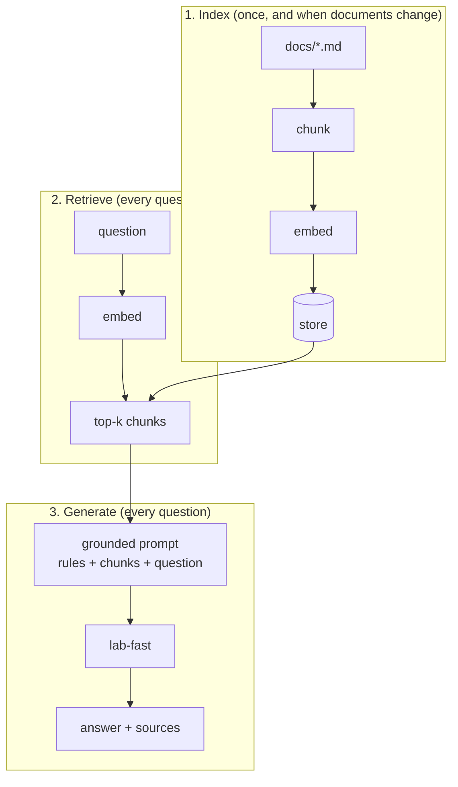

You've built every part of RAG separately. Now they join into one pipeline with three phases.



| Phase | Built in | Input | Output |
|---|---|---|---|
| Index | Topics 07-08 | A folder of documents | A store of chunks with vectors |
| Retrieve | Topics 06, 08 | A question | The k most similar chunks |
| Generate | Topic 03 | The chunks and the question | A grounded answer, or the refusal |

## The grounded prompt, with several chunks

Topic 03's prompt had one `<document>`. Now there are k of them, each labelled with its source:

```text
Answer the question using only the documents below.
If they do not contain the answer, reply exactly: I don't know based on the documents.

<document source="deploys.md">
# Deploys
Production deploys happen on Tuesdays and Thursdays at 14:00 UTC. ...
</document>

<document source="access.md">
# Production access
...
</document>
```

Labelling each chunk with its source lets the model (and you) see where each fact came from.

## Sources make answers checkable

A RAG answer should say **where it came from**. Then a reader can open `deploys.md` and verify it - which is exactly the trust problem from topic 01, solved. The simplest version: list the source files of the retrieved chunks under the answer.

```text
Run shipit rollback with the service name to roll back a bad release.

Sources: deploys.md, access.md
```

When the model refuses, show **no** sources: the chunks didn't contain the answer, so citing them would mislead.

## Choosing k

With 4 short documents, k=2 is plenty. Larger k makes it more likely the right chunk is included, but adds noise and cost to every prompt. Topic 12 shows how to choose it by measuring rather than guessing.
