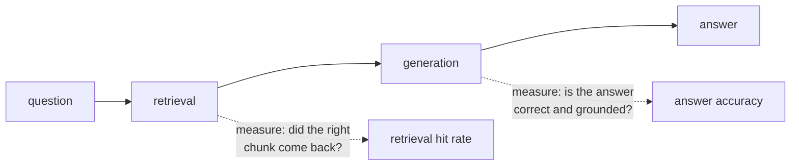

You asked your bot a few questions and the answers looked right. That's a demo, not evidence. Change the chunk size, the model, or k, and you have no idea whether things got better or worse.

**Evaluation** replaces "looks right" with numbers you can compare.

## Two things can fail, so measure two things

| Failure | Symptom | Measured by |
|---|---|---|
| Retrieval misses | The right chunk never reaches the prompt; the model refuses or guesses | **Hit rate @ k**: share of questions whose known source is in the top k |
| Generation fails | The right chunk is in the prompt, but the answer is wrong, incomplete, or ignores the refusal rule | **Answer accuracy**: share of answers that contain the expected fact, or refuse when they should |

Measure them **separately**. If answers are wrong and retrieval hit rate is 50%, fixing the prompt won't help - fix retrieval first. If hit rate is 100% but answers are wrong, look at the prompt or the model.

## Don't forget the questions with no answer

A RAG bot that answers everything is dangerous. Include questions the documents **can't** answer, and count a refusal as correct for those. This measures the "knows its limits" behaviour that grounding was meant to give you.

## Automatic is good enough to start

Checking whether the answer **contains** the expected fact (like `35 days`) is crude but fast and repeatable. Teams later add a model as a judge ("does this answer agree with the reference?") or human review. Start simple and automatic - a crude number you run on every change beats a perfect one you never run.
