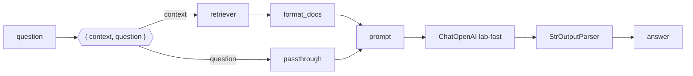

Now connect retriever, prompt, model and parser into one chain.

```python
from langchain_core.output_parsers import StrOutputParser
from langchain_core.prompts import ChatPromptTemplate
from langchain_core.runnables import RunnablePassthrough
from langchain_openai import ChatOpenAI

from retriever import get_retriever

REFUSAL = "I don't know based on the handbook."

prompt = ChatPromptTemplate.from_messages([
    ("system", "Answer the question using only the handbook excerpts below. "
               "If they do not contain the answer, reply exactly: " + REFUSAL + "\n\n{context}"),
    ("human", "{question}"),
])


def format_docs(docs):
    return "\n\n".join(f'<document source="{d.metadata["source"]}">\n{d.page_content}\n</document>' for d in docs)


llm = ChatOpenAI(model="lab-fast", temperature=0)

chain = (
    {"context": get_retriever(k=3) | format_docs, "question": RunnablePassthrough()}
    | prompt
    | llm
    | StrOutputParser()
)

print(chain.invoke("What should I do if my laptop is stolen?"))
```

```text
Report it to the IT service desk within one hour so it can be wiped remotely.
```

## Read the chain left to right



1. **The dict** runs both branches on the same input question: `context` goes through the retriever, then `format_docs` turns the `Document`s into tagged text; `question` passes through unchanged.
2. **`prompt`** fills `{context}` and `{question}` into the system and human messages.
3. **`llm`** sends them to `lab-fast` through your gateway.
4. **`StrOutputParser`** turns the reply message into a plain string.

It's the same grounded prompt as topic 10 - built from components instead of f-strings.

## Watch out for braces

`ChatPromptTemplate` treats `{name}` as a variable. The refusal sentence has no braces, so it's safe to concatenate. If your instructions ever contain literal braces (JSON examples, for instance), double them: `{{` and `}}`.

## Keep the exact refusal

The chain returns whatever the model says. Wrap it the same way as before:

```python
def ask(question):
    answer = chain.invoke(question).strip()
    return REFUSAL if "don't know based on the handbook" in answer.lower() else answer
```
