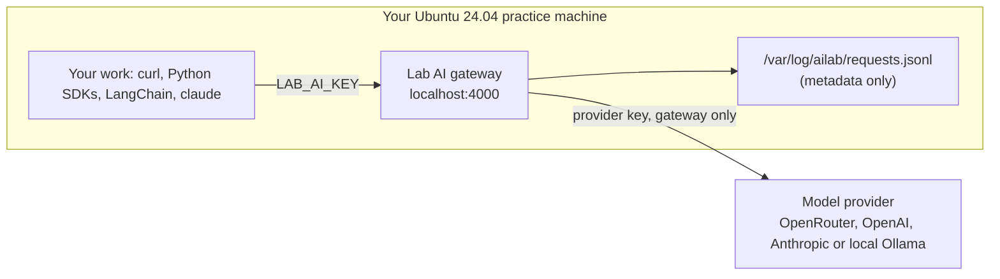

# Set Up Your Practice Machine

Every task in **AI Engineer** runs on a real Linux machine and calls real models. The tasks assume **Ubuntu 24.04**, logged in as **root**, with your home folder at `/root`.



Everything you build talks to the **lab AI gateway** on `http://localhost:4000` (a [LiteLLM](https://github.com/BerriAI/litellm) proxy). It gives you:

- **Five stable model names** (`lab-mini`, `lab-fast`, `lab-smart`, `lab-reasoning`, `lab-open`) that work the same whatever provider is behind them.
- **Both API shapes**: OpenAI chat completions (`/v1/chat/completions`) and the Anthropic Messages API (`/v1/messages`). curl, the `openai` and `anthropic` SDKs, LangChain, and Claude Code all work unchanged.
- **Key hygiene**: your scripts only ever see a throw-away **lab key**. Your real provider key stays in a root-only file used by the gateway alone.
- **A request log** that the **Check your work** scripts read to confirm what you ran. It records the model, client, token counts, and message roles, but never the prompt or reply text.

## 1. Get a machine

Any of these works. You need about **2 GB of memory** (8 GB if you choose local models with Ollama) and internet access.

| Option | Command |
|---|---|
| Multipass VM (recommended) | `multipass launch 24.04 --name ai-lab --cpus 2 --memory 4G --disk 20G && multipass shell ai-lab` |
| Docker container | `docker run -it --name ai-lab --hostname lab ubuntu:24.04 bash` (then `apt-get update && apt-get install -y curl`) |
| WSL 2 on Windows | `wsl --install -d Ubuntu-24.04` |
| Cloud VM | Any Ubuntu 24.04 instance - stop it when you're done |

Then become root with `sudo -i` (not needed in the Docker container).

## 2. Install the lab

```bash
curl -fsSL https://raw.githubusercontent.com/Hemanth9336/AI-Engineer/main/setup/ai-fundamentals/install-tools.sh | bash
source ~/.bashrc
```

The script installs:

| What | Where |
|---|---|
| The gateway (LiteLLM 1.106.3), its request logger, and four provider profiles | `/opt/ailab/venv`, `/usr/local/lib/ailab`, `/etc/ailab/profiles` |
| The `ailab` command | `/usr/local/bin/ailab` |
| A Python venv with `openai`, `anthropic`, `langchain`, and `langchain-openai` | `/root/ai-lab/.venv` (first on your `PATH`, so `python` uses it) |
| Claude Code (`claude`), pointed at the gateway instead of an Anthropic account | `/root/.local/bin/claude` |
| Your lab key and client settings, mode 600, loaded by `~/.bashrc` | `/root/.config/ailab/env` |
| Work folders | `/root/ai-lab`, `/root/answers` |

## 3. Choose a model provider

```bash
ailab setup
```

Pick one profile and paste its API key. The input is hidden, and the key is written only to `/etc/ailab/provider.env` (mode 600):

| Profile | You need | Approximate cost for the whole course | Notes |
|---|---|---|---|
| `openrouter` (recommended) | An [OpenRouter](https://openrouter.ai/keys) key with a few dollars of credit | Well under $5 | One key reaches OpenAI, Anthropic, and open models, so the model comparisons are the most interesting |
| `openai` | An [OpenAI API](https://platform.openai.com/api-keys) key | Well under $5 | All five aliases are OpenAI models |
| `anthropic` | An [Anthropic API](https://console.anthropic.com/) key | Under $10 | All five aliases are Claude models |
| `ollama` | Nothing - but 8 GB of memory, and [Ollama installed](https://ollama.com/download) first | Free | Runs small open models locally. It is slower, and answers are weaker, so a few tasks may need extra tries |

Costs depend on how much you experiment. Set a spending limit in your provider's dashboard; it's good practice anyway.

Check that everything answers:

```bash
ailab status    # gateway up? key files private?
ailab models    # the five lab models and the real model behind each
ailab test      # one tiny request to every lab model
```

The profile files map each alias to a provider model ID. Providers rename and retire models, so if `ailab test` reports an unknown model, edit `/etc/ailab/config.yaml` to a current ID and run `ailab restart`.

## Everyday commands

| Command | Does |
|---|---|
| `ailab up` / `ailab down` / `ailab restart` | Start, stop, or restart the gateway (it doesn't start on boot - run `ailab up` after a restart) |
| `ailab status` | Shows whether the gateway answers, which profile is active, and whether the key files are private |
| `ailab models` | Lists each alias and the model behind it |
| `ailab log [N]` | Shows the last N requests: time, API, model, client, finish reason, and tokens |
| `ailab setup PROFILE` | Switches provider, for example `ailab setup ollama` |

Gateway output is in `/var/log/ailab/gateway.log` if something goes wrong.

## Key hygiene, from day one

- Your code reads keys from the environment (`$LAB_AI_KEY`, or `OPENAI_API_KEY` and `ANTHROPIC_AUTH_TOKEN`, which the SDKs pick up automatically). **Never paste a key into a file.** Most checkers fail if your lab key appears anywhere in your work folder.
- The lab key only works on this machine's gateway. If you leak it, nothing outside the VM is exposed - but treat it as practice for real keys.
- Never commit `/root/.config/ailab/env` or `/etc/ailab/provider.env`. When you finish the course, revoke the provider key in your provider's dashboard.

## How "Submit" works here

Each task ends with a **Check your work** script. Paste it into your practice machine: every line should print ✅. Then press **Mark as complete** on the website - your progress is saved in your browser.

The checkers read the files you created and the gateway's request log, so run your work **through the gateway**, as the task says.

## Reset

Made a mess? Delete a task's folder in `/root/ai-lab` and start that task again, or throw the machine away:

```bash
multipass delete --purge ai-lab     # Multipass
docker rm -f ai-lab                 # Docker
```
