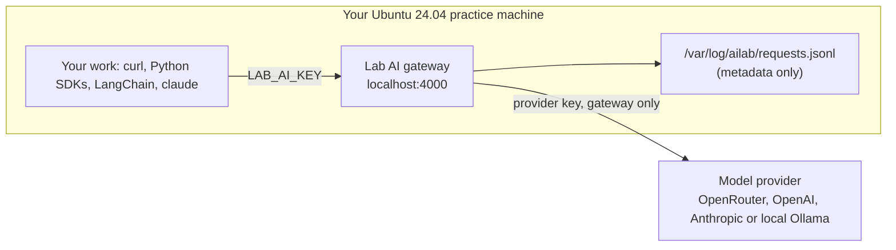

# Set Up Your Practice Machine

Every task in **AI Engineer** runs on a real Linux machine and calls real models. The tasks assume **Ubuntu 24.04**, logged in as **root**, with your home folder at `/root`.



Everything you build talks to the **lab AI gateway** on `http://localhost:4000` (a [LiteLLM](https://github.com/BerriAI/litellm) proxy). It gives you:

- **Five stable model names** (`lab-mini`, `lab-fast`, `lab-smart`, `lab-reasoning`, `lab-open`) that work the same whatever provider is behind them.
- **Both API shapes**: OpenAI chat completions (`/v1/chat/completions`) and the Anthropic Messages API (`/v1/messages`). curl, the `openai` and `anthropic` SDKs, LangChain, and Claude Code all work unchanged.
- **Key hygiene**: your scripts only ever see a throw-away **lab key**. Your real provider key stays in a root-only file used by the gateway alone.
- **A request log** that the **Check your work** scripts read to confirm what you ran. It records the model, client, token counts, and message roles, but never the prompt or reply text.

## 1. Get a machine

Any of these works. You need about **2 GB of memory** (8 GB if you choose local models with Ollama) and internet access.

| Option | Command |
|---|---|
| Multipass VM (recommended) | `multipass launch 24.04 --name ai-lab --cpus 2 --memory 4G --disk 20G && multipass shell ai-lab` |
| Docker container | `docker run -it --name ai-lab --hostname lab ubuntu:24.04 bash` (then `apt-get update && apt-get install -y curl`) |
| WSL 2 on Windows | `wsl --install -d Ubuntu-24.04` |
| Cloud VM | Any Ubuntu 24.04 instance - stop it when you're done |

Then become root with `sudo -i` (not needed in the Docker container).

## 2. Install the lab

```bash
curl -fsSL https://raw.githubusercontent.com/Hemanth9336/AI-Engineer/main/setup/ai-fundamentals/install-tools.sh | bash
source ~/.bashrc
```

The script installs:

| What | Where |
|---|---|
| The gateway (LiteLLM 1.106.3), its request logger, and four provider profiles | `/opt/ailab/venv`, `/usr/local/lib/ailab`, `/etc/ailab/profiles` |
| The `ailab` command | `/usr/local/bin/ailab` |
| A Python venv with `openai`, `anthropic`, `langchain`, and `langchain-openai` | `/root/ai-lab/.venv` (first on your `PATH`, so `python` uses it) |
| Claude Code (`claude`), pointed at the gateway instead of an Anthropic account | `/root/.local/bin/claude` |
| Your lab key and client settings, mode 600, loaded by `~/.bashrc` | `/root/.config/ailab/env` |
| Work folders | `/root/ai-lab`, `/root/answers` |

## 3. Choose a model provider

```bash
ailab setup
```

Pick one profile and paste its API key. The input is hidden, and the key is written only to `/etc/ailab/provider.env` (mode 600):

| Profile | You need | Approximate cost for the whole course | Notes |
|---|---|---|---|
| `openrouter` (recommended) | An [OpenRouter](https://openrouter.ai/keys) key with a few dollars of credit | Well under $5 | One key reaches OpenAI, Anthropic, and open models, so the model comparisons are the most interesting |
| `openai` | An [OpenAI API](https://platform.openai.com/api-keys) key | Well under $5 | All five aliases are OpenAI models |
| `anthropic` | An [Anthropic API](https://console.anthropic.com/) key | Under $10 | All five aliases are Claude models |
| `ollama` | Nothing - but 8 GB of memory, and [Ollama installed](https://ollama.com/download) first | Free | Runs small open models locally. It is slower, and answers are weaker, so a few tasks may need extra tries |

Costs depend on how much you experiment. Set a spending limit in your provider's dashboard; it's good practice anyway.

Check that everything answers:

```bash
ailab status    # gateway up? key files private?
ailab models    # the five lab models and the real model behind each
ailab test      # one tiny request to every lab model
```

The profile files map each alias to a provider model ID. Providers rename and retire models, so if `ailab test` reports an unknown model, edit `/etc/ailab/config.yaml` to a current ID and run `ailab restart`.

## 4. Add the RAG tools (RAG skill)

The **RAG** skill needs an embedding model and a vector database on top of the lab above. On the same machine, run:

```bash
curl -fsSL https://raw.githubusercontent.com/Hemanth9336/AI-Engineer/main/setup/rag/install-tools.sh | bash
source ~/.bashrc
```

If the lab isn't installed yet, the script installs it first (then run `ailab setup` as in step 3). It adds:

| What | Where |
|---|---|
| `lab-embed`: a local embedding model (all-MiniLM-L6-v2, 384 dimensions) served on `127.0.0.1:4001` and routed through the gateway | `/opt/ailab/embed`, `/usr/local/lib/ailab/embed_server.py` |
| `chromadb`, `langchain-chroma` and `langchain-text-splitters` | `/root/ai-lab/.venv` |
| Work folders | `/root/rag-start`, `/root/rag-lab`, `/root/answers` |

`lab-embed` runs on your machine, so embeddings are **free** and identical whichever provider profile you chose. Chat answers still come from your provider through `lab-fast`. Check both:

```bash
ailab status    # gateway and embeddings both answering?
ailab test      # includes one lab-embed request
```

Embedding calls appear in the request log with `"api": "embeddings"` and an `inputs` count.

## 5. Add the FDE tools (AI Forward Deployed Engineer skill)

The **AI Forward Deployed Engineer** skill uses everything from steps 2-4, plus a few extras. On the same machine, run:

```bash
curl -fsSL https://raw.githubusercontent.com/Hemanth9336/AI-Engineer/main/setup/fde/install-tools.sh | bash
source ~/.bashrc
```

The script installs or refreshes the RAG lab first, then adds:

| What | Where |
|---|---|
| `lab-tiny`: the same model as `lab-mini`, but with a 2,048-token input window - so you can hit a context limit on purpose without spending much (topic 04) | An extra entry in `/etc/ailab/config.yaml` |
| `mcp` 1.30.0 (the Model Context Protocol SDK, for the MCP server in topic 22) and `jsonschema` 4.26.0 (schema validation in topic 10) | `/root/ai-lab/.venv` |
| Work folder - each topic uses `/root/fde-lab/NN-<short>` | `/root/fde-lab` |

Check it:

```bash
ailab models    # now lists lab-tiny too
ailab test
```

A few tasks start a small local service in **Set up** - a mock customer API, or a deliberately slow model endpoint - on `127.0.0.1` ports `4555`, `4560` and `4570`. They run until the machine restarts; Set up starts them again if they aren't answering.

## 6. Add the harness tools (Harness Engineering skill)

The **Harness Engineering** skill uses everything from step 5 (Claude Code, `mcp`, `lab-embed` and `lab-tiny`), plus a scripted test model. On the same machine, run:

```bash
curl -fsSL https://raw.githubusercontent.com/Hemanth9336/AI-Engineer/main/setup/harness/install-tools.sh | bash
source ~/.bashrc
```

The script installs or refreshes the FDE lab first, then adds:

| What | Where |
|---|---|
| `labmock`: a stand-in for a chat model that replays a script you write (a tool call, a model that never stops, a slow or failing reply), so you - and the checkers - can test harness code without depending on what a real model happens to say | `/opt/harness/labmock.py` |
| Work folder - each topic uses `/root/harness-lab/NN-<short>` | `/root/harness-lab` |

Your harness code always uses `OpenAI()`, so it runs against the real gateway or against `labmock` unchanged: `labmock` sets `OPENAI_BASE_URL` for the process it starts. A few tasks also run `labmock` from the shell on `127.0.0.1` ports `4596`-`4599`, and the final capstone starts a mock ticket API on port `4581`.

Topics 34-37 drive **Claude Code** (`claude -p`) against the gateway. Every scripted run passes `--max-turns`, so a confused run can't loop forever.

## 7. Add the Claude Code tools (Claude Code Fundamentals skill)

The **Claude Code Fundamentals** skill needs only Claude Code and a few command-line tools, so it doesn't depend on steps 2-6. On any Ubuntu 24.04 machine, run:

```bash
curl -fsSL https://raw.githubusercontent.com/Hemanth9336/AI-Engineer/main/setup/claude-code/install-tools.sh | bash
source ~/.bashrc
claude          # first run only: sign in with your Claude account
```

| What | Where |
|---|---|
| `git`, `jq`, `curl`, `python3` and `python3-venv` - the tools the tasks and checkers call | apt |
| Node.js 22 - topic 01 records its version (the `claude` CLI is a native binary and doesn't need it) | apt (NodeSource) |
| Claude Code, from the native installer | `/root/.local/bin/claude` |
| `mcp` 1.30.0, for the MCP server in topic 15 - this venv is first on `PATH`, so `python3` finds it | `/root/cc-lab/.venv` |
| Work folder - each topic uses `/root/cc-lab/NN-<short>` | `/root/cc-lab` |

**Signing in.** With a Claude account, `claude` asks you to log in once and remembers you. If you installed the AI Fundamentals lab (step 2), you can skip sign-in: `~/.bashrc` already sets `ANTHROPIC_BASE_URL` and `ANTHROPIC_AUTH_TOKEN`, so Claude Code talks to the lab gateway, and `haiku` maps to `lab-mini` through `ANTHROPIC_DEFAULT_HAIKU_MODEL`.

Two things the tasks rely on:

- **Folder trust.** The first time you run `claude` in a new folder, it asks whether you trust that folder. Until you accept, Claude Code ignores the folder's `allow` rules in `.claude/settings.json`, though `deny` rules always apply. Tasks that need allow rules say when to accept the prompt.
- **Model precedence.** `/model` beats `--model`, which beats the `ANTHROPIC_MODEL` environment variable, which beats the `model` setting. The gateway lab sets `ANTHROPIC_MODEL`, so topic 16 runs `env -u ANTHROPIC_MODEL claude ...` when it tests the setting.

Checkers read Claude Code's own session files in `~/.claude/projects/` and the `--output-format stream-json` files your runs save. Run each task inside its own folder, as the task says.

## 8. Add the Claude Code Mastery tools (Claude Code Mastery skill)

The **Claude Code Mastery** skill builds on step 7 and adds the tools its later topics use. It doesn't depend on steps 2-6. On any Ubuntu 24.04 machine, run:

```bash
curl -fsSL https://raw.githubusercontent.com/Hemanth9336/AI-Engineer/main/setup/claude-code-mastery/install-tools.sh | bash
source ~/.bashrc
claude          # first run only: sign in with your Claude account
```

| What | Where |
|---|---|
| `git`, `jq`, `curl`, `ripgrep`, `python3` and `python3-venv` - the tools the tasks and checkers call | apt |
| `bubblewrap` and `socat` - Claude Code's Bash sandbox on Linux (topics 006 and 029) | apt |
| `cron` - scheduled runs (topics 022 and 061) | apt |
| Node.js 22 and `mcp-server-filesystem` - the filesystem MCP server (topics 031 and 032) | apt (NodeSource), npm |
| Claude Code, from the native installer | `/root/.local/bin/claude` |
| `mcp` 1.30.0, `claude-agent-sdk` and `pyyaml` - this venv is first on `PATH`, so `python3` finds them | `/root/mastery/.venv` |
| Settings for scripts that run outside your shell (cron jobs source this file). An existing file from step 2 is kept | `~/.config/ailab/env` |
| Work folder - each topic uses `/root/mastery/NNN-<short>`; the capstone (081-088) uses `/root/mastery/NNN-release-manager` | `/root/mastery` |
| Codex CLI, optional, for topic 037 (`INSTALL_CODEX=1` before the command above). The checker works without it | npm |

**Signing in.** As in step 7: sign in once with a Claude account, or use the AI Fundamentals gateway (step 2), whose settings are already in your environment. Some topics cover features that need a claude.ai plan and can't run on a gateway: Remote Control, cloud sessions, Claude in Chrome, Desktop and artifacts (075-080). Those topics are lessons and scenarios, with no graded tasks.

A few things the tasks rely on:

- **Ports.** Topic 068 runs a small OpenTelemetry collector on `127.0.0.1:14318`, and the capstone's verdict API (087) listens on `127.0.0.1:18787`.
- **systemd.** Topic 087 uses `systemd-run --user` when your machine has a user systemd. Containers and macOS don't, so the task's script falls back to a background process with a pid file, and the checker accepts either.
- **Git.** Several topics (the capstone especially) create small git repositories. The script sets a default `user.name` and `user.email` if you don't have them.

## Everyday commands

| Command | Does |
|---|---|
| `ailab up` / `ailab down` / `ailab restart` | Start, stop, or restart the gateway (it doesn't start on boot - run `ailab up` after a restart) |
| `ailab status` | Shows whether the gateway answers, which profile is active, and whether the key files are private |
| `ailab models` | Lists each alias and the model behind it |
| `ailab log [N]` | Shows the last N requests: time, API, model, client, finish reason, and tokens |
| `ailab setup PROFILE` | Switches provider, for example `ailab setup ollama` |

Gateway output is in `/var/log/ailab/gateway.log` if something goes wrong.

## Key hygiene, from day one

- Your code reads keys from the environment (`$LAB_AI_KEY`, or `OPENAI_API_KEY` and `ANTHROPIC_AUTH_TOKEN`, which the SDKs pick up automatically). **Never paste a key into a file.** Most checkers fail if your lab key appears anywhere in your work folder.
- The lab key only works on this machine's gateway. If you leak it, nothing outside the VM is exposed - but treat it as practice for real keys.
- Never commit `/root/.config/ailab/env` or `/etc/ailab/provider.env`. When you finish the course, revoke the provider key in your provider's dashboard.

## How "Submit" works here

Each task ends with a **Check your work** script. Paste it into your practice machine: every line should print ✅. Then press **Mark as complete** on the website - your progress is saved in your browser.

The checkers read the files you created and the gateway's request log, so run your work **through the gateway**, as the task says.

## Reset

Made a mess? Delete a task's folder in `/root/ai-lab` and start that task again, or throw the machine away:

```bash
multipass delete --purge ai-lab     # Multipass
docker rm -f ai-lab                 # Docker
```
